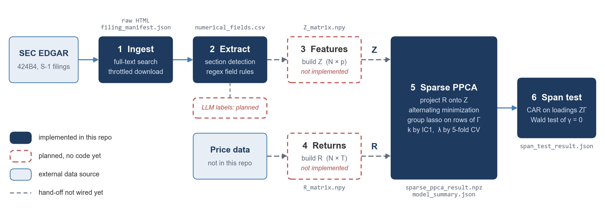
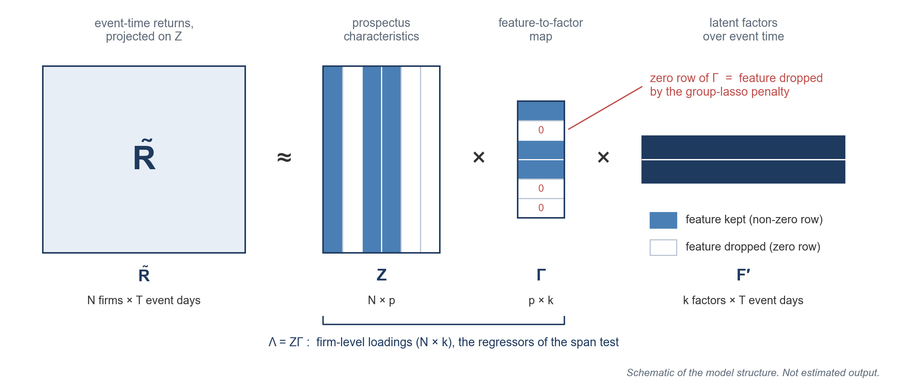

# IPO Overhang Sparse PPCA

IPO 투자설명서에서 락업 오버행 특성을 추출하고, 그 특성이 결정하는 잠재 팩터로 락업 해제일 전후 수익률을 설명하려는 연구용 파이프라인이다. 구현이 끝나지 않은 상태다.

*A work-in-progress research pipeline that extracts lock-up overhang characteristics from SEC IPO prospectuses (Form 424B4) and estimates the latent factors they span in event-time returns around lock-up expiration, using a group-lasso-penalized projected PCA.*



> **현재 상태.** 이 저장소에는 데이터와 추정 결과가 들어 있지 않다. 커밋된 코드만으로는 파이프라인이 처음부터 끝까지 실행되지 않는다. 그림에서 점선으로 그린 단계는 아직 코드가 없고, 구현된 단계에도 [알려진 문제](#한계와-남은-작업)가 있다. 따라서 이 문서는 성능 수치나 실증 결과를 제시하지 않는다.

## 개요

IPO 기업의 내부자와 기존 주주 지분은 상장 후 일정 기간 매도가 제한된다(lock-up). 제한 기간과 대상 물량은 공모 시점의 투자설명서(Form 424B4)에 기재되므로, 락업 해제는 날짜와 규모가 미리 알려진 공급 이벤트다.

이 프로젝트가 묻는 질문은 두 가지다.

1. 투자설명서에서 뽑은 오버행 특성(해제 물량 비율, 공모가 조정 폭 등)이 락업 해제일 전후 수익률의 공통 변동을 설명하는가.
2. 여러 특성 가운데 설명에 실제로 기여하는 것은 무엇인가.

후보 특성이 많아질 때 변수 선택과 팩터 추출을 한 번에 하려고, 특성이 팩터 로딩을 결정하는 구조에 group lasso 페널티를 더한 모형을 쓴다.

## 방법론



*모형 구조 개념도. 추정 결과가 아니다.*

입력은 수익률 행렬 $R$ (기업 $N$ × 이벤트 일 $T$, 락업 해제일이 $t=0$)과 특성 행렬 $Z$ ($N$ × 특성 $p$, 열별 표준화)이다. 먼저 $R$ 을 $Z$ 의 열공간에 사영해 $\tilde{R} = Z(Z^\top Z)^{-1}Z^\top R$ 을 만들고, 다음 목적함수를 최소화한다.

```math
\min_{\Gamma,\,F}\; \lVert \tilde{R} - Z\Gamma F^\top \rVert_F^2 \;+\; \lambda \sum_{j=1}^{p} \lVert \Gamma_{j\cdot} \rVert_2
```

- $\Gamma$ ($p \times k$)는 특성을 로딩으로 옮기는 행렬이다. 페널티가 행 단위로 걸리므로 한 특성의 행 전체가 0이 되면 그 특성은 모형에서 빠진다.
- $F$ ($T \times k$)는 이벤트 타임 축의 잠재 팩터이고, 기업별 로딩은 $\Lambda = Z\Gamma$ 이다.
- 추정은 교대 최소화다. $\Gamma$ 를 고정하면 $F$ 는 OLS로, $F$ 를 고정하면 $\Gamma$ 는 특성별 OLS 해에 group soft-thresholding(임계값 $\lambda/2$)을 적용해 갱신한다. SVD 기반 초기값 한 번과 난수 초기값으로 `n_init` 회 반복한 뒤 목적함수가 가장 작은 해를 고른다.
- 팩터 수 $k$ 는 $\lambda = 0$ 에서 1부터 `k_max` 까지 추정해 Bai & Ng (2002)의 IC1이 최소인 값으로 정한다.
- $\lambda$ 는 기업 단위 5-fold 교차검증에서 표본 외 MSE가 최소인 값을 등비 그리드에서 고른다.

검증 단계(span test)는 락업 해제일 주변 누적 비정상 수익률(CAR)을 로딩에 횡단면 회귀한다.

```math
CAR_i = \alpha + \gamma^\top \Lambda_i + \varepsilon_i, \qquad H_0:\ \gamma = 0
```

Wald 통계량 $W = \hat{\gamma}^\top \hat{V}^{-1} \hat{\gamma}$ 를 $\chi^2(k)$ 분포와 비교하고, 절편 $\alpha$ 의 t-통계량을 함께 기록한다. CAR은 시장 수익률이 주어지면 시장조정 방식으로, 없으면 횡단면 평균을 차감해 계산한다.

## 파이프라인 단계

| 단계 | `--stage` | 모듈 | 하는 일 | 산출물 | 코드 |
|---|---|---|---|---|---|
| 1 수집 | `ingest` | `src/ingestion/edgar_crawler.py` | EDGAR full-text search로 표본 기간의 424B4, S-1 목록 조회. 회사명 키워드로 SPAC 제외. 초당 9회로 제한한 다운로드와 지수 백오프 재시도 | `data/raw/html/`, `data/interim/filing_manifest.json` | 있음 |
| 2 추출 | `extract` | `src/features/numerical_extractor.py` | 424B4 HTML에서 섹션을 찾은 뒤 정규식으로 공모가, 공모가 밴드, 락업 일수, 해제 물량, 공모 후 주식 수, 주관사 추출. 파생 변수(`unlock_pressure`, `price_update_abs`, `filing_range_width`) 계산과 핵심 필드 결측 점검 | `data/interim/numerical_fields.csv` | 있음 (LLM 라벨링은 없음) |
| 3 특성 행렬 | 없음 | 없음 | $Z$ 구성 | `data/processed/Z_matrix.npy`, `feature_names.json` | 없음 |
| 4 수익률 행렬 | 없음 | 없음 | $R$ 구성 | `data/processed/R_matrix.npy`, 선택 사항 `market_returns.npy` | 없음 |
| 5 추정 | `model` | `src/models/sparse_ppca.py` | $k$ 선택, $\lambda$ 선택, Sparse PPCA 추정 | `data/results/sparse_ppca_result.npz`, `model_summary.json` | 있음 |
| 6 검증 | `evaluate` | `src/evaluation/span_test.py` | 윈도 [-1, 1], [-5, 5], [-10, 10]의 CAR 계산과 span test | `data/results/span_test_result.json` | 있음 |

## 저장소 구조

```
run_pipeline.py                      # CLI 진입점
configs/config.yaml                  # 표본 기간, EDGAR 요청 설정, 모형·평가 하이퍼파라미터, 경로
src/ingestion/edgar_crawler.py       # 1단계
src/features/numerical_extractor.py  # 2단계
src/models/sparse_ppca.py            # 5단계
src/evaluation/span_test.py          # 6단계
src/utils/config.py                  # YAML 로더, 로거 설정, 경로 루트
assets/                              # README 그림
requirements.txt
```

## 실행 방법

Python 3.10 이상이 필요하다.

```bash
git clone https://github.com/summerjinhere/ipo-sparse-ppca.git
cd ipo-sparse-ppca
pip install -r requirements.txt
```

`requirements.txt` 에는 아직 코드가 없는 단계에서 쓸 패키지(sentence-transformers, gensim, chromadb 등)도 들어 있다. 현재 코드가 import하는 것만 설치하려면 다음으로 충분하다.

```bash
pip install numpy pandas scipy requests beautifulsoup4 lxml pyyaml python-dotenv tqdm loguru
```

SEC는 자동화된 요청에 연락처를 담은 User-Agent를 요구한다. 셸 환경 변수나 저장소 루트의 `.env` 파일에 `SEC_USER_AGENT` 를 넣는다. 설정하지 않으면 코드에 적힌 자리표시자 값이 그대로 전송된다. 현재 코드는 LLM API 키를 읽지 않는다.

```
SEC_USER_AGENT="Your Name your-email@example.com"
```

```bash
python run_pipeline.py --stage ingest   --config configs/config.yaml
python run_pipeline.py --stage extract  --config configs/config.yaml
python run_pipeline.py --stage model    --config configs/config.yaml
python run_pipeline.py --stage evaluate --config configs/config.yaml
```

| 옵션 | 값 | 기본값 |
|---|---|---|
| `--stage` | `all`, `ingest`, `extract`, `model`, `evaluate` | `all` |
| `--config` | 설정 YAML 경로 | `configs/config.yaml` 을 쓰도록 되어 있으나 지금은 생략하면 찾지 못한다 (아래 알려진 문제 참고) |
| `--log-level` | `DEBUG`, `INFO`, `WARNING`, `ERROR` | `INFO` |

`--stage all` 은 ingest, extract, model, evaluate를 차례로 호출한다. `model` 과 `evaluate` 는 3, 4단계 산출물(`Z_matrix.npy`, `R_matrix.npy`, `feature_names.json`)이 이미 있어야 하는데, 이를 만드는 코드는 저장소에 없다.

코드가 실제로 읽는 설정 키는 `data.sample.start_year`·`end_year`, `data.edgar.rate_limit_per_sec`·`retry_max`·`timeout_sec`, `data.event_window.pre_days`, `model.ppca.k_max`·`max_iter`·`tol`·`n_init`, `model.sparse.lambda_grid_size`, `project.seed`, `evaluation.span_test.significance_level`·`bootstrap_reps`, `evaluation.car_windows`, `paths.raw_html`·`interim`·`processed`·`results` 다. 그 밖의 키(`features.*`, `model.cv.*`, `data.sample.exclude.*` 등)는 설계를 적어 둔 것으로 아직 코드와 연결되어 있지 않다.

추정기만 따로 쓸 수도 있다. `lambda_val` 을 직접 주면 교차검증을 건너뛴다.

```python
from src.models.sparse_ppca import SparsePPCA

model = SparsePPCA(k=2)
result = model.fit(R, Z, lambda_val=0.05)   # R: (N, T), Z: (N, p). λ 값은 데이터 스케일에 맞춘다
print(result.selected_features, result.Gamma.shape, result.F.shape)
```

## 한계와 남은 작업

데이터와 산출물은 저장소에 없다(`data/`, `logs/`, `*.csv`, `*.parquet` 은 `.gitignore` 대상). 결과를 보려면 수집부터 다시 실행해야 하며, 그 전에 아래 문제를 고쳐야 한다. 목록은 커밋된 코드를 읽고 작은 난수 배열로 점검해 확인한 내용이다.

- 3, 4단계(특성 행렬, 수익률 행렬)와 LLM 라벨링이 구현되어 있지 않다. 텍스트 파생 특성과 매크로 변수도 `config.yaml` 에 이름만 있다. 주가 데이터를 수집하는 코드도 없다.
- `src/utils/config.py` 의 `ROOT` 가 저장소 루트가 아니라 `src/` 를 가리킨다. `--config` 를 생략하면 설정 파일을 찾지 못하고, 산출물과 로그는 `src/data/`, `src/logs/` 아래에 만들어진다.
- 수집 단계가 저장하는 HTML 파일명과 추출 단계가 여는 파일명의 규칙이 서로 달라, 추출 단계가 파일을 찾지 못한다. 크롤러의 응답 필드명과 URL 조립도 실제 EDGAR 응답으로 검증하지 않았다.
- `SparsePPCA.fit` 은 $\lambda$ 교차검증 경로에서 `TypeError` 로 멈춘다. `lambda_val` 을 직접 주는 경로와 `select_k` 는 난수 배열에서 동작했다. 같은 점검에서 목적함수가 반복마다 단조 감소하지는 않았으므로, 수렴 성질은 따로 확인이 필요하다.
- span test의 순열 기반 p-value(`boot_p_value`)는 분산 계산식에 오류가 있어 신뢰할 수 없다. $\chi^2$ p-value 계산은 이 오류와 무관하다.
- `model`, `evaluate` 단계는 결과 JSON을 저장할 때 NumPy 정수·불리언 값을 그대로 넘겨 직렬화 오류가 난다.
- 추출 규칙은 정규식의 첫 매칭을 쓰고, 락업 그룹이 여럿일 때 합산하지 않으며, 주관사는 고정된 이름 목록으로만 찾는다. 추출 정확도는 측정하지 않았다. 테스트 코드도 없다.

남은 작업의 순서는 위 문제 수정, 3·4단계 구현, 추출값의 수작업 대조, 합성 데이터에서 추정기가 알려진 $\Gamma$ 를 복원하는지 확인, 실제 표본 추정이다.

## 데이터 출처

- SEC EDGAR의 공개 공시 Form 424B4와 S-1. 목록은 full-text search(`efts.sec.gov/LATEST/search-index`)에서, 원문은 `www.sec.gov/Archives` 에서 받도록 작성되어 있다. 기본 표본 기간은 2018~2024년이다.
- 주가와 시장 수익률은 출처가 코드에 정해져 있지 않다. `requirements.txt` 에 yfinance가 있지만 이를 쓰는 코드는 없다.
- 코드 주석이 참조하는 문헌: Fan, Liao & Wang (2016, Annals of Statistics), Kelly, Pruitt & Su (2019, JFE), Bybee et al. (Narrative Asset Pricing), Bai & Ng (2002), Field & Hanka (2001), Hanley (1993).

---

김재하 (Jaeha Kim) · [github.com/summerjinhere](https://github.com/summerjinhere)
